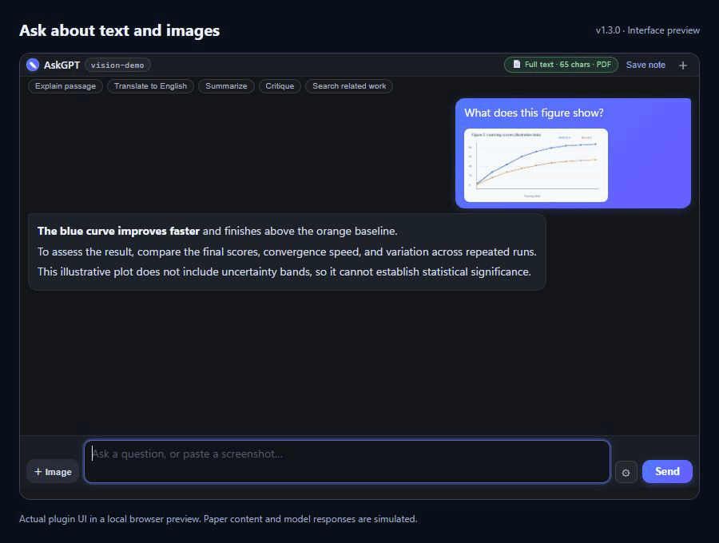
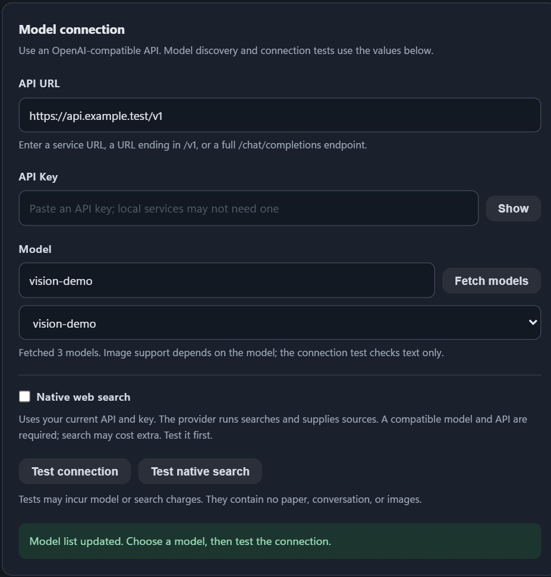
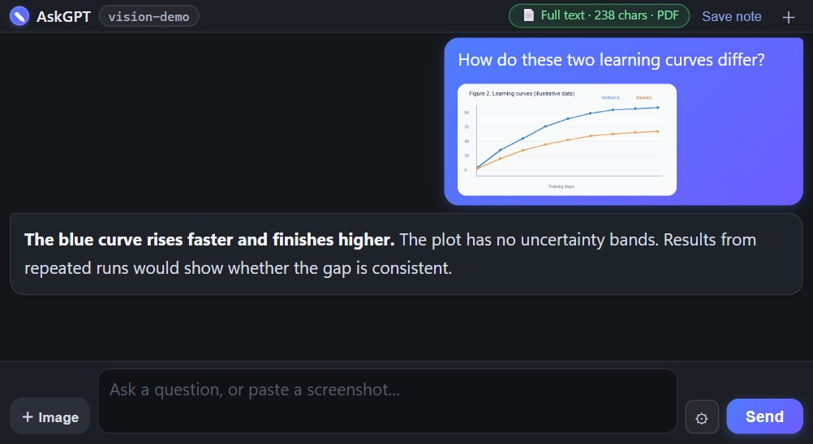
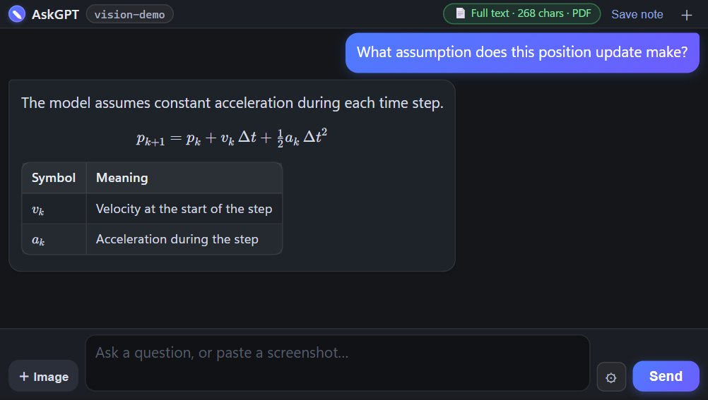

[简体中文](docs/zh-CN.md) · **English**

# AskGPT — AI Paper Reader for Zotero

Select a passage in Zotero and press **Ctrl+K** (**Cmd+K** on Mac) to ask about it with the paper open beside you. AskGPT uses the available paper text, can take a figure with your question, and lets you save an answer as a Zotero note.

[Download askgpt.xpi](https://github.com/Marco0431/askgpt-zotero/releases/latest/download/askgpt.xpi) · [Install and try](#install-and-try) · [User guide](docs/guide.md)

## Interface preview

_The walkthrough and screenshots show the plugin interface with sample paper content and responses._

## Install and try

1. Download **askgpt.xpi**. In Zotero, open **Tools → Plugins**, choose **Install Plugin From File…** from the gear menu, select the file, and restart Zotero.
2. Open a paper, press **Ctrl+K** or **Cmd+K**, and open **Settings**. Enter your provider’s API URL and key. Use **Fetch models** to choose a model, or enter its ID.
3. Click **Test connection**, then **Save and return**. Select a passage and ask, “Which assumption does this argument depend on?”

Your configured provider receives the question, available paper context, conversation history, and images you send. Provider charges may apply. Web search is off by default.

## Ask about a figure

Paste a screenshot into the question box or click **＋ Image**. With a model that supports images, try asking, “Where do these curves start to diverge, and what can we tell from the plot alone?”

## Keep an answer with the paper

Ask for an explanation of the symbols in an equation. AskGPT displays equations and Markdown tables in the reader. After checking the answer against the paper, click **Save note** to keep the latest answer as a note in Zotero.

[Model settings and web search](docs/guide.md#model-settings) · [Troubleshooting](docs/guide.md#troubleshooting) · [Development](docs/guide.md#development) · [Report an issue](https://github.com/Marco0431/askgpt-zotero/issues/new/choose)
