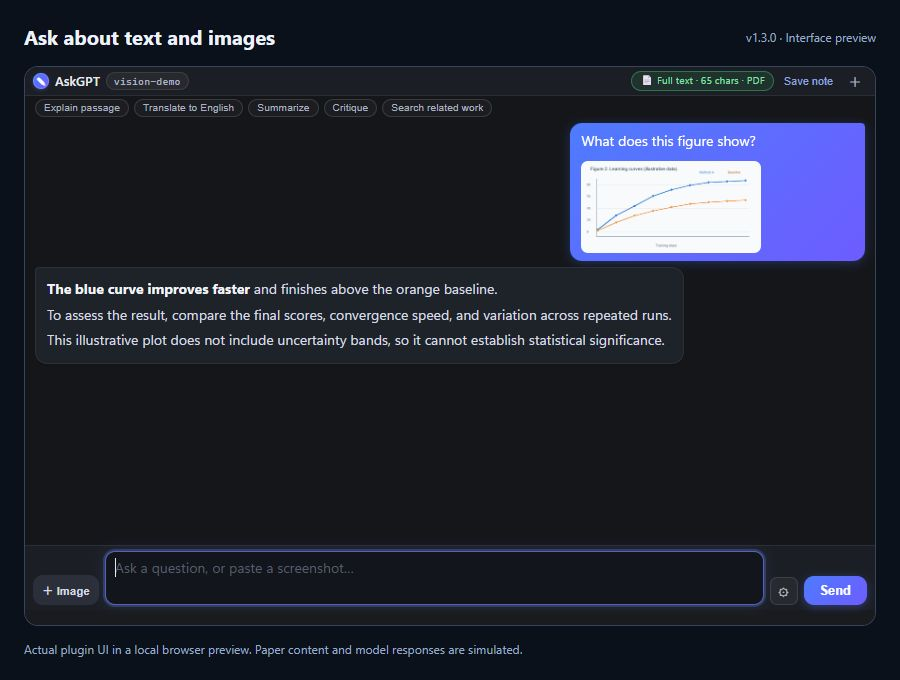
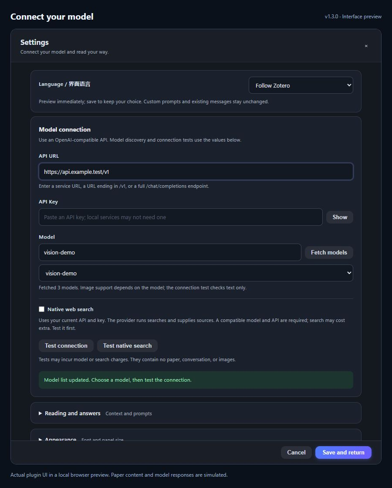
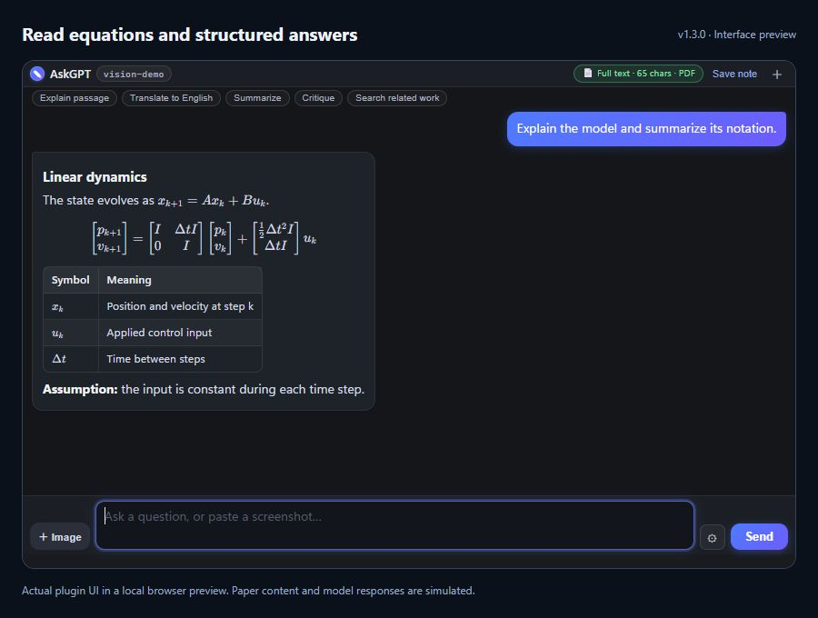

[English](README.md) · **简体中文**

# AskGPT — Zotero AI 文献阅读助手 / AI Paper Reader

> 在 Zotero 里选中论文段落，按 `Ctrl+K` 提问：结合文献全文解释概念、翻译段落，并把回答保存为 Zotero 笔记。

AskGPT is a Zotero plugin for asking questions about research papers without leaving the reader. It combines selected text with available attachment context, streams answers with Markdown and math rendering, and connects to a user-configured OpenAI-compatible API, including DeepSeek.

[下载插件 / Download](https://github.com/Marco0431/askgpt-zotero/releases/latest/download/askgpt.xpi) · [English guide](README.md) · [问题反馈 / Issues](https://github.com/Marco0431/askgpt-zotero/issues) · [文档索引 / llms.txt](llms.txt)

[](https://www.zotero.org)
[](LICENSE)
[](https://github.com/Marco0431/askgpt-zotero/releases)

## 界面预览

**文字与图片一起问。** 添加论文图表或粘贴截图，结合问题一起讨论。



<details>
<summary>模型设置：API 配置、获取模型与连接测试</summary>

填写 API 信息、拉取模型列表，测试连接后再保存。图片与联网搜索能力取决于提供商和模型。



</details>

<details>
<summary>回答排版：Markdown 表格与数学公式</summary>

在对话中直接阅读排版后的解释、公式和表格。



</details>

以上为插件真实界面的本地浏览器预览，文献内容与 API 回答均为模拟示例，API 地址为占位地址。截图展示英文界面，设置中可切换为简体中文。

## 快速开始

1. 下载上方的 `askgpt.xpi`，在 Zotero 的 **工具 → 插件** 中选择 **Install Plugin From File…**，安装后重启。
2. 打开论文，按 `Ctrl+K`（macOS 可用 `Cmd+K`）打开 AskGPT，在面板的 **⚙ 设置** 中填写自己的 API 地址和 API Key。默认接口为 DeepSeek。
3. 点击 **获取模型**，选择模型后点击 **测试连接**；接口不提供模型列表时，也可以手动填写模型 ID。确认后保存设置。模型问答和连接测试均可能产生提供商费用。
4. 选中论文中的一段文字，输入问题；也可以添加或粘贴截图、论文图表一起提问。需要保留回答时点击 **存为笔记**。

可直接尝试的提问：

> 请结合全文解释这段话中的方法，指出它依赖的假设；原文没有说明的内容请明确标注。

适合论文阅读、段落翻译、方法解释和文献笔记。对话会将可读取的文献上下文、选中文字、对话历史及你发送的图片交给配置的模型接口；开启提供商联网搜索后，由该提供商执行搜索。Markdown 和公式的本地排版不等于模型问答可以离线运行。

需要桌面版 Zotero，以及支持流式 Chat Completions 的模型接口。安装清单声明的版本范围不代表每个版本和操作系统都完成了实机验证；图片与联网能力也取决于所选提供商和模型。

---

## ✨ 为什么用 AskGPT？

| 😩 痛点                                   | ✅ 解决方案                                                              |
| ----------------------------------------- | ------------------------------------------------------------------------ |
| 读论文遇到不懂的段落，要复制粘贴到网页 AI | 选中文字 → `Ctrl+K` → 直接在 Zotero 里问                                 |
| 提问要反复附上文献全文，token 烧得快      | **固定上下文前缀**：为提供商的缓存复用创造条件，是否命中与费用取决于接口 |
| 换一段文字要关窗重开                      | 📡 **实时跟踪选中**：重新选中，面板内容自动切换                          |
| AI 回答里的公式和表格看不清               | 🧮 **真渲染**：Markdown + KaTeX 离线排版，公式不再是源码                 |
| 弹窗被 Zotero 主窗口盖住、大小不合心意    | 📌 **内嵌浮动面板**：永远最前，可拖动、可拖拽缩放、记位置                |

---

## 🚀 功能一览

### 🧠 智能问答 Agent

- 基于**选中的文献原文**回答问题：解释概念、概括方法、分析结果、批判性评价、翻译……
- 支持**提供商原生联网搜索**（Responses API 的 `web_search`）：模型按需调用提供商的搜索能力，复用现有 API Key
- 流式输出、可中断、回答可一键**存为 Zotero 笔记**

### 📚 支持多种文献上下文

| 场景                              | 方式                                                      |
| --------------------------------- | --------------------------------------------------------- |
| 📄 **PDF 阅读器**                 | 选中文字 → `Ctrl+K`，AI 拿到**整篇论文** + 你选中的那一段 |
| 🌐 **HTML / 📝 MD / 📃 TXT 附件** | 选中条目 → `Ctrl+K`，自动读取整篇全文（上限 12 万字符）   |
| 🖱️ **面板里直接框选**             | 在 AI 回答里划选文字 → 自动成为「选中段落」随问题发送     |

### 📖 整篇论文上下文 & 真实公式渲染

- **可读取的文献作为固定上下文**：打开面板会尝试读取全文（上限 12 万字符）并作为固定前缀发送；选中文字只作为「选中段落」（焦点）附加在本次问题前，**不会**把全文顶掉，也不会清空对话历史
  - **来源自动选择**：默认用你**正在读的那个文件**（在读 PDF 就用 PDF 全文；在读译文 HTML 就用译文）；也可以在 设置 → AskGPT →「整篇文献的来源」里固定成 **PDF 优先** 或 **译文优先**（译文附件里的公式是完整 LaTeX）
  - 同一篇文献的其它附件依次兜底（PDF / Markdown / HTML / TXT）；某一路读不到文字（比如扫描版 PDF）会自动换下一路
  - PDF 优先使用新鲜且完整的 Zotero 全文索引；索引不完整或已过期时尝试重新抽取。只能取得部分文本时会标记不完整
  - HTML 译文里的 KaTeX 公式会还原成原始 LaTeX（`$...$` / `$$...$$`）；读不到全文时会明确提示「本次只发送选中段落」
- **真·Markdown + KaTeX 渲染**（随插件离线打包 `markdown-it` + `KaTeX`，不联网）：
  - 标题 / 表格 / 引用 / 删除线 / 有序无序列表 / 代码块 / 链接全部真渲染
  - 行内公式 `$...$`、`\(...\)`，块级公式 `$$...$$`、`\[...\]` 用 KaTeX 排版
  - 没被 `$` 包起来的裸上下标（`F_t`、`J^T`、`x_{k+1}`）做视觉 `<sub>/<sup>` 兜底
- **思考模式兼容**：普通 Chat Completions 对话保留提供商返回的 `reasoning_content`；具体兼容性仍取决于接口和模型

### 🔥 省钱的缓存机制

- **API 前缀缓存**：`[system + 全文]` 作为固定前缀，同一篇文献反复提问时尽量保持前缀不变；每次请求仍会携带上下文，缓存是否命中及计费由接口提供商决定
- **本地全文缓存**：按文件版本校验，合并并发读取；设有容量和过期限制，文件更新后重新读取
- **按文章分会话**：Zotero 运行期间按文献保留对话历史，切文献互不干扰；需要长期保留的回答请存为笔记

### 📌 内嵌浮动面板

- 面板是 Zotero 窗口的一部分，**永远不会被主窗口盖住**
- 默认 **900 × 520**（宽而短，空间几乎全给对话）；拖动标题栏可移动、位置自动记忆
- **可拖拽缩放**：右下角把手（另附右边缘、下边缘）拖动即改尺寸，松手写回设置；也可以在 设置 → 面板大小 里直接填 `宽x高`，范围 420×360 ~ 1600，且不会超出 Zotero 窗口
- **多尺寸自适应**：宽 < 560px 时省略标题、徽章收成短文案；高 < 560px 时顶部整体压紧；高 < 440px 时收起快捷提示行；宽 > 1100px 时对话内容居中限宽（≈1040px），避免一行过长
- 顶部只有一行（约 50px）：模型徽章 + 两个状态徽章（`📄 整篇文献 12.3k 字 · PDF 全文`、`🎯 选中 41 字`）；读不到全文时第一个徽章变黄提示「仅发选中段落」
- 快捷提示 chips 单行横向滚动，把高度让给对话
- AI 气泡宽度用满面板（不再留 12% 空白），公式、表格在气泡里正常排版
- **字号可调**：设置 → 字体大小（12 / 13 / 14 / 15 / 16 / 18 px，默认 14），保存后立即生效，无需重启
- **⚙ 设置按钮在输入框旁边**；设置在独立覆盖面板中打开。点击「保存并返回」才会应用改动；点击「取消」、右上角 `✕` 或按 `Esc` 会丢弃未保存输入，恢复已保存配置并返回对话（不会隐藏整个 AskGPT 面板）
- 工具栏显示 **AskGPT**，单击打开、再次单击关闭；`Ctrl+K` / `Cmd+K` 打开或聚焦面板。独立阅读器窗口使用该窗口正在阅读的文献。
- `Esc` 或标题栏 ✕ 隐藏面板，`Ctrl+K` 再次唤起

### ⚙️ 连接、外观与高级设置

- **面板内设置**（⚙ 在输入栏）：先完成连接配置，外观和高级选项另行分组。保留接口地址、API Key、模型、温度、字体大小、面板大小、整篇文献来源、系统提示词及联网开关。
- **中英双语界面**：设置最上方可选择「跟随 Zotero」「简体中文」或「English」。选择后立即预览，点击「保存并返回」才保留；取消、右上角 × 或 Esc 会恢复已保存语言。设置、快捷问题和状态提示都会随语言切换，已有对话内容不翻译。
- **双语默认提示词**：中文界面默认用简体中文回答，英文界面默认用英语回答，也可以在提问中指定其他语言。默认提示词优先回答具体问题，区分论文证据和推测，对缺失信息或看不清的图片明确说明。旧内置提示词会更新；自己写过的提示词保持不变，可在「阅读与回答」中继续编辑。
- **获取模型**：使用当前填写的接口地址和 Key 拉取模型列表，不必从旧的固定名单中猜型号。接口不支持获取列表时，仍可以手填模型 ID。
- **测试连接**：使用当前填写的配置发送一条简短文本请求，不携带论文、图片或聊天历史；可能产生少量 API 费用。测试和获取模型不会替你保存设置。
- **测试联网搜索**：单独验证当前接口与模型是否实际执行了服务端搜索，不携带论文、图片或聊天历史，不保存设置；可能产生搜索工具费及模型费用。
- **保存并返回**：确认连接参数后应用设置并返回对话。取消、右上角 `✕` 和 `Esc` 均不会保存输入；获取模型和测试连接也不会自动保存。
- **Zotero → 设置 → AskGPT**：仍可编辑核心项（接口地址、API Key、模型、温度、联网开关）。获取模型和测试连接位于阅读面板内。

无需认证的本地兼容服务可将 API Key 留空。模型列表由提供商返回，其中可能包含不支持聊天、图片或联网搜索的模型；列表也不一定声明这些能力。文本连接测试成功不代表图片输入或原生搜索一定可用。

### 🌐 提供商联网搜索

**提供商联网搜索默认关闭**，首次使用或从旧版升级后都需要在设置的「连接」区域手动开启。启用后，AskGPT 使用已配置的 API 地址和 Key，通过 OpenAI 兼容的 **Responses API** 请求内置 `web_search` 工具，无需另填搜索服务的 Key。是否需要搜索由模型决定，开启后并非每个问题都会联网。

- **DeepSeek 官方接口**：文档指定端点为 `https://api.deepseek.com/responses`，原生 `web_search` 仅明确支持 `deepseek-v4-pro`；`deepseek-flash` 会忽略该工具。参见 [DeepSeek Responses API 兼容说明](https://api-docs.deepseek.com/zh-cn/guides/responses_api/)。
- **xAI 官方接口**：在 `https://api.x.ai/v1/responses` 支持 `web_search`。应选择 xAI 文档明确支持该工具的模型，参见 [xAI Web Search](https://docs.x.ai/developers/tools/web-search)。
- **其他提供商或代理**：只兼容 Chat Completions 并不够，接口还必须支持 Responses 并实际执行 `web_search`。请先点击连接设置中的**测试联网搜索**；只有服务端实际执行搜索才会报告成功。拉取到模型或文字测试成功，都不能证明联网可用。不支持时可关闭提供商联网搜索，继续普通问答。

联网可能增加提供商的搜索工具费及模型 token 费用，搜索测试也可能计费；以 [DeepSeek Search 定价](https://api-docs.deepseek.com/guides/search/#billing)和 [xAI 工具定价](https://docs.x.ai/developers/pricing#tools-pricing)为准。搜索与图片是两项独立能力，支持其中一项不代表同时支持另一项。

搜索由你配置的提供商处理；AskGPT 不抓取 DuckDuckGo，也不会自动切换到其他搜索服务。来源链接取决于提供商返回的内容，重要信息应打开原始页面核对。

### 🖼️ 图片提问

- 点击输入框旁的图片按钮选择文件，或直接粘贴剪贴板中的图片；发送前可预览、移除。
- 支持 **PNG、JPEG、WebP**，每条消息最多 **4 张**，单张不超过 **8 MB**，合计不超过 **20 MB**。
- 可以将截图、论文图表与文字问题一起发送，也可以只发送图片。
- 所选接口和模型需要支持当前协议的图片输入：Chat Completions 使用 `image_url`，Responses 使用 `input_image`；不按模型名字猜测图片能力。若接口拒绝图片，请换用支持图片的模型，或移除图片后继续文字问答。
- 图片在点击发送后发给你配置的模型接口；同一对话的后续请求可能继续携带此前图片作为上下文。图片不会自动加入 Zotero 文献库。

---

## 📦 安装

1. 下载最新版 `.xpi`：[Releases](https://github.com/Marco0431/askgpt-zotero/releases)（文件：`askgpt.xpi`）
2. Zotero → **工具(Tools) → 插件(Plugins)**
3. 把 `.xpi` **拖进插件窗口**（或 齿轮 → Install Plugin From File…）
4. 重启 Zotero

> 首次使用：打开 AskGPT 面板的 **⚙ 设置**，填入 API 地址 / Key，获取或填写模型并测试连接，然后保存。也可在 Zotero 的 **设置 → AskGPT** 中编辑核心配置。

---

## 🎮 使用演示

```
1️⃣ 打开任意 PDF → 选中一段看不懂的文字
2️⃣ 按 Ctrl+K（或点阅读器工具栏的 AskGPT 按钮）
3️⃣ 输入问题 → Enter
4️⃣ 看完回答，选中下一段 → 面板自动切换「选中段落」，继续问
5️⃣ 点「存为笔记」把回答存进 Zotero 笔记
```

---

## 🔧 开发

```bash
# 克隆
git clone https://github.com/Marco0431/askgpt-zotero.git
cd askgpt-zotero

# 安装锁定依赖
npm ci

# 开发构建
npm run build
# 产物在 .scaffold/build/askgpt.xpi
```

`npm test` 的准备步骤会在 `.scaffold/test-fixtures` 生成隔离模块，再运行 Gecko 集成测试。Linux CI 会执行全文缓存、窗口状态、工具栏、请求及真实 Markdown/KaTeX 渲染测试。本地运行集成测试应使用独立开发配置并关闭其他 Zotero 实例，参见 [`.env.example`](.env.example)；仅运行 `npm run test:prepare` 不会启动 Zotero。

构建后运行 `npm run check:package` 可核对运行资源及 WOFF2 字体，并防止测试、源码映射或开发文件进入 XPI；CI 构建和发布流程都会执行该检查。

### 🏗️ 项目结构

```
src/
├── index.ts              # 入口：挂载 Zotero.AskGPT 实例
├── hooks.ts              # 生命周期：启动/关闭/窗口事件
├── addon.ts              # 插件数据类
└── modules/
    ├── popup.ts          # 内嵌面板：创建/拖动/缩放/会话缓存
    ├── fulltext.ts       # 整篇文献读取：PDF 全文 / HTML 译文 / Markdown 源
    ├── reader.ts         # PDF 选中捕获/顶栏按钮/右键菜单/实时同步
    └── prefs.ts          # 设置页注册与读写
addon/
├── content/
│   ├── popup.xhtml       # 面板界面
│   ├── popup.css         # 面板样式（含多尺寸断点）
│   ├── preferences.xhtml # 设置页
│   ├── scripts/
│   │   ├── client.js     # 接口地址、获取模型、连接测试与图片读取
│   │   ├── native-search.js # 提供商 Responses 搜索与引用
│   │   ├── i18n.js       # 面板中英文文案
│   │   ├── prompts.js    # 共享双语默认提示词
│   │   ├── popup.js      # 面板逻辑（agent 问答 + 流式 + 联网搜索）
│   │   └── mathrender.js # 渲染层：markdown-it + KaTeX
│   └── vendor/           # 离线打包的 markdown-it / KaTeX（含字体）
└── bootstrap.js          # Zotero 插件入口
```

---

## 🧩 技术亮点

- 🎯 官方 `Zotero.Reader.registerEventListener` 捕获 PDF 选中（`renderTextSelectionPopup`），实时推送面板
- 📦 基于 [zotero-plugin-template](https://github.com/windingwind/zotero-plugin-template)（windingwind 官方模板）+ [zotero-plugin-toolkit](https://github.com/windingwind/zotero-plugin-toolkit)
- 🔌 普通问答使用 OpenAI 风格的 Chat Completions 接口；提供商联网搜索要求支持 Responses API 的内置 `web_search`，实际能力取决于所选接口与模型
- 📝 插件不内置模型服务；文献上下文发往你配置的接口，启用联网搜索后由该提供商执行搜索

---

## 🙏 致谢

- [windingwind/zotero-plugin-template](https://github.com/windingwind/zotero-plugin-template) —— 插件开发模板
- [windingwind/zotero-plugin-toolkit](https://github.com/windingwind/zotero-plugin-toolkit) —— 工具库
- [zotero-pdf-translate](https://github.com/windingwind/zotero-pdf-translate) —— Reader API 参考

---

## 📄 License

[AGPL-3.0](LICENSE)

---

> 💡 有问题？开个 [Issue](https://github.com/Marco0431/askgpt-zotero/issues) 📮 或顺手点个 ⭐ 支持一下！
