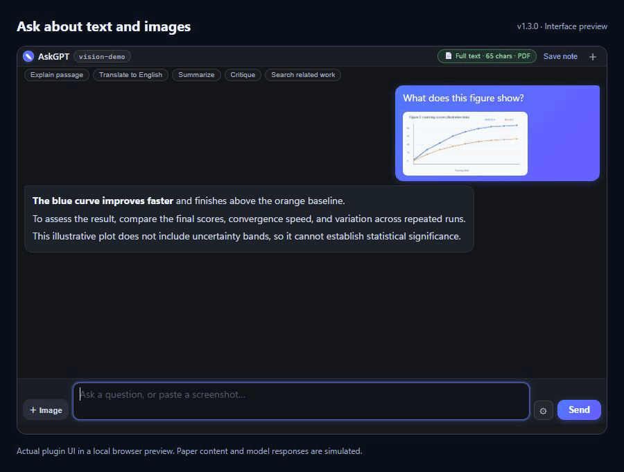
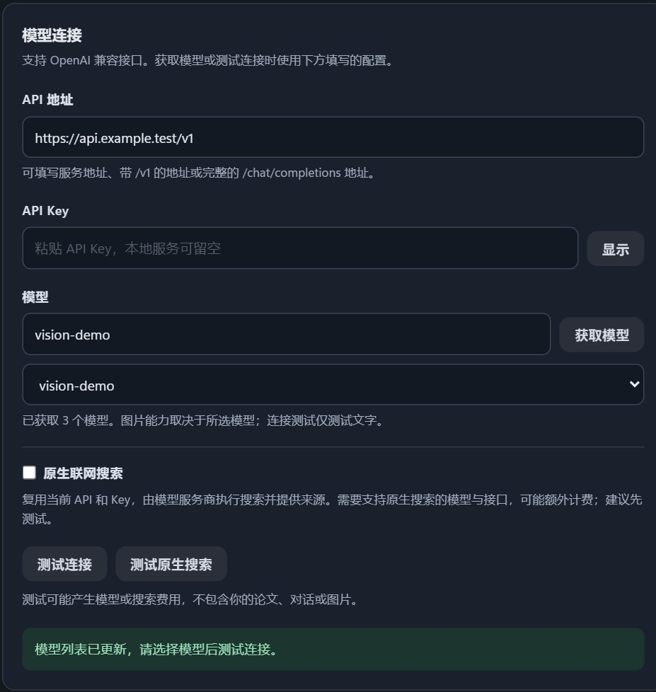
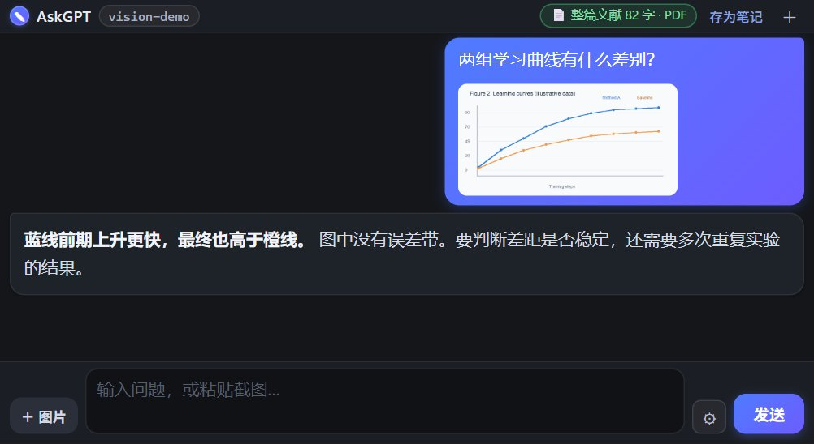
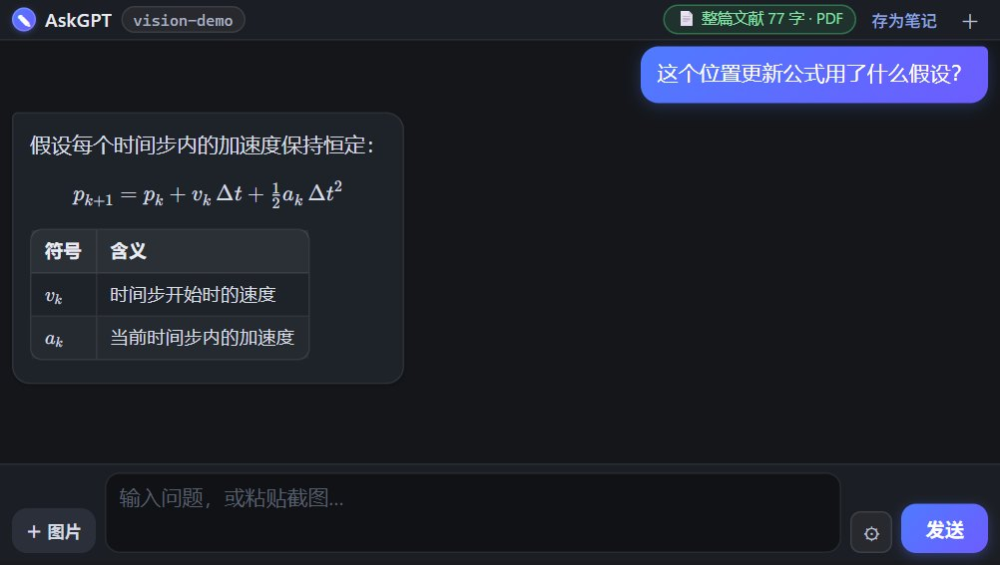

[English](../README.md) · **简体中文**

# AskGPT — Zotero AI 文献阅读助手

读论文时，选中一段话，按 **Ctrl+K**（Mac 用 **Cmd+K**），就能在 Zotero 里结合论文上下文提问。看不懂图，可以把截图一起发过去；想留下一条解释，可以把回答存为文献笔记。

[下载 askgpt.xpi](https://github.com/Marco0431/askgpt-zotero/releases/latest/download/askgpt.xpi) · [快速开始](#快速开始) · [使用手册](guide.zh-CN.md)

## 界面预览

_动图和截图使用插件界面，文献和回答均为演示内容。_

## 快速开始

1. 下载 **askgpt.xpi**，打开 Zotero 的**工具 → 插件**，将文件拖进插件窗口，安装后重启。
2. 打开一篇论文，按 **Ctrl+K** 或 **Cmd+K**，进入面板的**设置**。填入服务商提供的 API 地址和密钥，点击**获取模型**，或手动填写模型 ID。
3. 点击**测试连接**，成功后点**保存并返回**。选中一段文字，试着问：“作者这一步推理依赖什么假设？”

提问时，你配置的模型服务商会收到问题、可用的论文上下文、对话历史和发送的图片，并可能收费。联网搜索默认关闭。

## 对着论文里的图提问

把图粘贴到输入框，或点击 **＋ 图片**。选择支持图片的模型，然后问：“两条曲线从哪里开始拉开差距？只看这张图，能得出什么结论？”

## 把看懂的内容留在文献旁

遇到公式，可以请模型逐个解释符号。面板能显示公式和 Markdown 表格。对照原文核对后，点击**存为笔记**，就能把这条回答保存在 Zotero 里。

[模型设置与联网搜索](guide.zh-CN.md#模型设置) · [常见问题](guide.zh-CN.md#常见问题) · [开发说明](guide.zh-CN.md#开发) · [反馈问题](https://github.com/Marco0431/askgpt-zotero/issues/new/choose)
